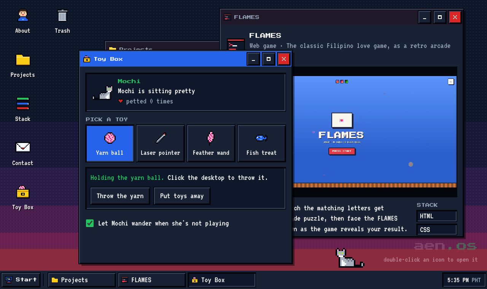

<div align="center">

# aen.os

**My portfolio, shaped like a tiny retro operating system.**

Open windows, drag them around, dig through the trash, and play with Mochi the cat.

**[Visit aen.os →](https://aencruz.github.io/aen-os/)**




</div>

---

## What's inside

| | |
|---|---|
| **Boot screen** | A short fake BIOS boot. Skip it with the button, any key or a click. Shows once per session. |
| **Desktop** | Icons for About, Projects, Stack, Contact, Toy Box and Trash. Click to select, double-click to open. |
| **Windows** | Open, close, minimize, maximize, drag, and click to bring to front. One reusable `<Window>` component drives all of them. |
| **Taskbar** | Start menu, a button for every open window, and a clock in Philippine time. |
| **Projects** | A file-explorer grid. Each project opens its own window with a screenshot, features, stack and links. |
| **Mochi** | A pixel cat who wanders, naps, and purrs when you pet her. |
| **Toy Box** | Pick a toy for Mochi: yarn ball, laser pointer, feather wand or fish treat. She chases, pounces, bats and eats. |
| **Trash** | Contains two files you probably shouldn't open. |
| **Phone layout** | Below 768px it becomes a phone OS: app icons, full-screen apps, and the back gesture goes back one screen. |

## Projects featured

- **[SkinSight](https://aencruz.github.io/SkinSight/)**: AI-assisted skin health preparation tool (Node.js, Express, Supabase, Gemini)
- **[Pawductivity](https://github.com/AENCRUZ/Pawductivity)**: a digital pet productivity system (C#, .NET 8 WinForms)
- **[FLAMES](https://aencruz.github.io/flames-love-calculator/)**: the classic Filipino love game as a retro arcade level (HTML, CSS, JavaScript)

## Accessibility

Retro shouldn't mean hard to use.

- **Keyboard:** Tab to an icon and press Enter to open it; Esc closes a window and returns focus to whatever opened it.
- **No dragging required:** focus a window's title bar and use the arrow keys to move it (Shift for bigger steps), or maximize it.
- **Start menu:** arrow keys, Home/End, and Esc to close.
- **Mochi without a mouse:** every toy has a button that plays for you ("Throw the yarn", "Wiggle the laser"...).
- **Reduced motion:** animations switch off and Mochi naps instead of wandering.
- One high-contrast yellow focus ring everywhere, and 44px touch targets on the phone layout.

## Run it locally

Requires [Node.js](https://nodejs.org/) 20 or newer.

```bash
npm install
npm run dev      # http://localhost:5173
npm run build    # production build in dist/
```

## Make changes

| To change... | Edit |
|---|---|
| Name, bio, email, links, projects, stack, Trash jokes | `src/data/content.ts` |
| Project screenshots | add images to `public/projects/` and list them in `content.ts` |
| Colors and fonts | CSS variables at the top of `src/index.css` |
| The cat's name | `name` in `src/cat/catStore.ts` |

## Deploy

Every push to `main` builds and publishes the site with GitHub Actions (`.github/workflows/deploy.yml`).

One-time setup: **Settings → Pages → Build and deployment → Source: GitHub Actions**.
If the live site shows a blank white page, this is the setting to check: "Deploy from a branch" publishes the unbuilt source, which browsers can't run.

## How it's built

```
src/
├── os/
│   ├── windows.ts       window state: one array + a reducer (open, close, focus, minimize, maximize, move)
│   ├── apps.tsx         app registry: title, icon, default size, what to render
│   └── OsContext.ts     openApp(): opens a window on desktop, or a full-screen app on phones
├── components/
│   ├── Window.tsx       drag (pointer events), bring to front, keyboard move, Esc to close
│   ├── Desktop.tsx      icons + windows + focus management
│   ├── Taskbar.tsx      start menu, window buttons, clock
│   ├── MobileOS.tsx     phone layout, back button wired to browser history
│   ├── BootScreen.tsx   the fake boot
│   └── PixelIcon.tsx    pixel sprites drawn from character grids as crisp SVG
├── cat/
│   ├── CatLayer.tsx     Mochi's behavior loop (requestAnimationFrame) and toys
│   ├── catStore.ts      shared state between the cat and the Toy Box
│   └── sprites.ts       Mochi's poses and the toys
├── apps/                About, Projects, ProjectDetail, Stack, Contact, Trash, ToyBox
└── data/content.ts      all the personal content
```

Every icon and sprite is hand-drawn as a grid of characters and rendered as SVG, so there are no image files for the UI and nothing gets blurry.
Fonts are [Press Start 2P](https://fonts.google.com/specimen/Press+Start+2P) and [VT323](https://fonts.google.com/specimen/VT323), self-hosted through Fontsource.

## Contact

**Angelyn Cruzat** · Computer Science, Batangas State University

[GitHub](https://github.com/AENCRUZ) · [LinkedIn](https://www.linkedin.com/in/angelyn-cruzat-3ab330388/) · angelyncruzat123@gmail.com
